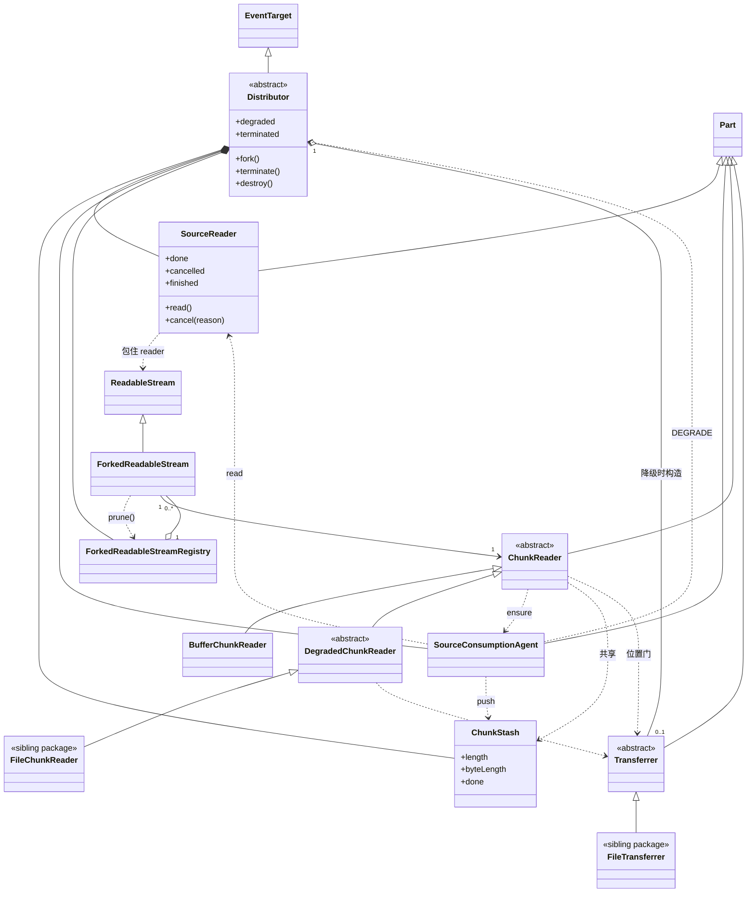
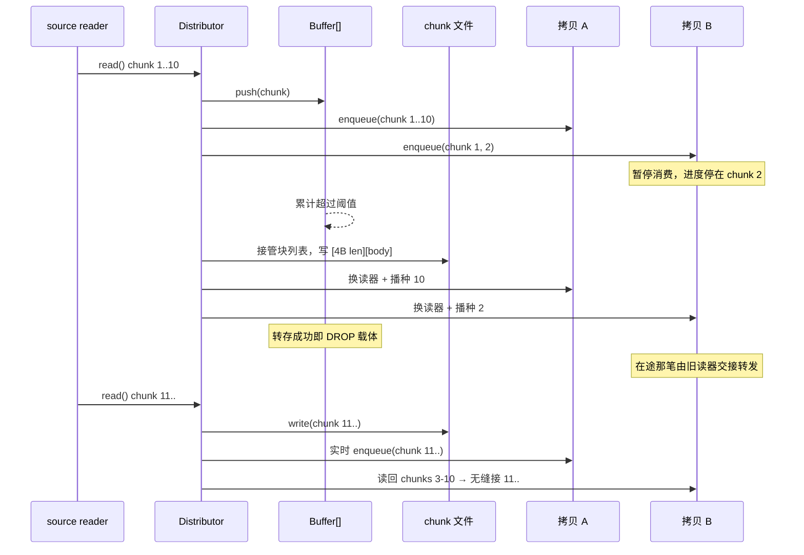
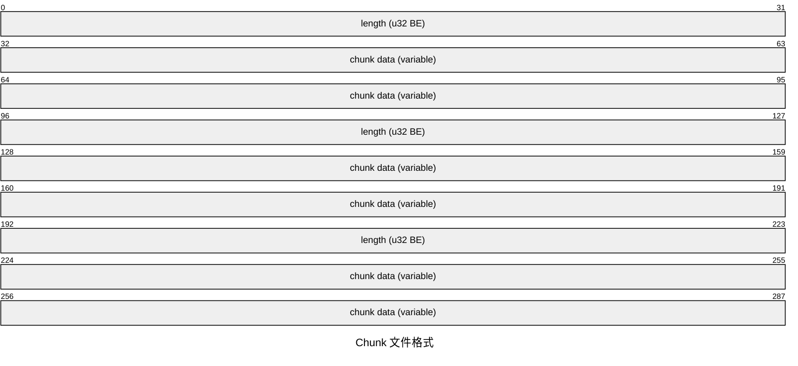
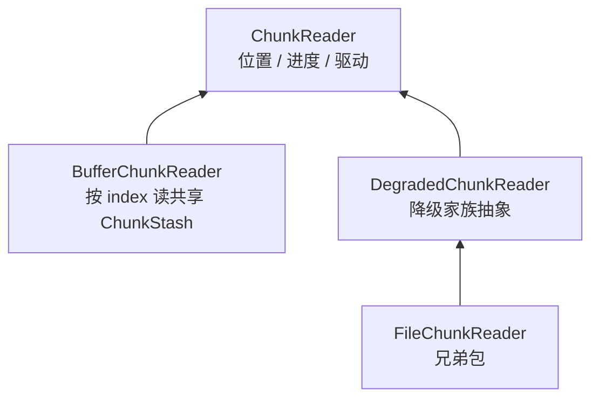

# ReadableStreamDistributor 设计文档

> 本文是 `@produck/fugue` 的正式设计，只写**当前结论**：目标、语义、
> API、架构与约定、阶段切换、存储格式、各成员、生命周期、背压、异常面、
> 可观测性。被废弃的概念与演进过程不入本文；框架层开放项见 `TODO.md`。

## 目标

`ReadableStream` 是单消费者模型——chunk 被一个消费者读走就从流中消失。
分发器打破这个限制：将一个源流分发给多个消费者，每个获得完整、独立的
拷贝。消费进度互不干扰——快的不用等慢的，慢的不会丢数据。

源推进速率由全体消费者中最快的那一个自然驱动，慢者从介质追赶。
当所有消费者停止消费时，源流自动释放。

支持内存缓存自动溢出到介质，chunk 边界保持一致。

## 核心语义

```text
主入口流（唯一真实来源）
  → fork() → ForkedReadableStream（每个拷贝一条）
  → 拷贝各自消费，进度私有
  → 任一拷贝 cancel 或读到尾都不影响其他
  → 提前终止 = cancel 自己的拷贝流
  → 全部拷贝离开 → source reader.cancel()
  → destroy() = 关闸门 + 封口 + 切断源 + 当场结束所有拷贝
```

- 交付是**非守恒复制**：每次交付都是从第 0 字节起的完整一份，介质里
  只存一份。
- 拷贝只从介质读，不接触源；源只有分发器一个消费者。
- 两个相位（内存 / 介质）对拷贝的 chunk 边界完全一致。
- 阶段切换对拷贝透明，同一 tick 内完成。
- 源在构造时被 `getReader()` 锁死，独占至分发器对象死亡——永不
  `releaseLock()`。

## API

`ReadableStreamDistributor` 是**抽象类**：不能直接 `new`，下游须继承。

- `constructor(source)`：`source` 必须是**本 realm** 的、未被锁定的
  WHATWG `ReadableStream`（判据就是 `instanceof`；跨 realm 转移过来的
  流到达时已经是接收 realm 的真流，直接可传。只有**直接引用**别的 realm
  造出来的对象才过不了这条判据，那要宿主自己包一层）。
- `fork()`：注册一个拷贝，答 `ForkedReadableStream`；终止后抛。
- `get degraded`：观察 `$I.TRANSFERRER` 是否落位（相位只有一个事实来源）。
- `get terminated`。
- `terminate()`：只关闸门，幂等。
- `destroy()`：闸门 + 封口 + 切断源 + 收摊；幂等，返回同一个 Promise。
- `setTransferrerArgs(...args)`：预置写侧构造参数（落 `I.TRANSFERRER_ARGS`，
  经写侧家族的 `_S.PARSE_ARGUMENTS` 归一，分发器不解释）。
- `get options`：三入口（构造、`fork`、`Tune`）冻结后的同一份快照。
- `getWarningCount(code)`：按 code 计数（未报过返回 `0`；非 code 抛
  `TypeError`）。

抽象契约（下游继承时声明，经 `SYMBOL` 开到宿主）：

- `Distributor._S.DEGRADED_CHUNK_READER_CTOR`：策略侧给出的降级读取器
  **类**，降级时用它就地构造各 fork 的新读器。
- `DegradedChunkReader._S.TRANSFERRER_CTOR`：该家族配套的写侧**类**。
- `Transferrer._I.INITIALIZE` / `_I.DUMP` / `_I.WRITE` / `_I.DROP`：
  写侧四个阶段钩子（`_I.DUMP` 基类有默认实现）。
- `Transferrer._S.PARSE_ARGUMENTS`：构造参数归一（基类恒等）。

两个静态槽都由 `@produck/es-abstract-member-constructor` 的
`SubConstructorOf(...)` 收紧；具体子类声明了静态成员就必须先用
`SubConstructorProxy(cls)` 注册再构造，否则 `new` 当场抛。

## 架构

### 模块

| 模块                           | 职责                                   |
| ------------------------------ | -------------------------------------- |
| `Distributor`                  | 抽象分发器：拷贝表、相位切换、生命周期 |
| `Part`                         | 元件的具体基类：持分发器、报告出口     |
| `ChunkReader`                  | 拷贝侧读头的抽象：位置与进度驱动       |
| `BufferChunkReader`            | 内存相读器：按 index 读共享 stash      |
| `DegradedChunkReader`          | 降级家族抽象：惰性初始化、读回、定位   |
| `Transferrer`                  | 写侧抽象：就绪、交付、排空、放开       |
| `ChunkStash`                   | 共享内存缓冲容器                       |
| `SourceReader`                 | 分发器侧拉取装置（锁死源）             |
| `SourceConsumptionAgent`       | 唯一源消费方：单飞拉取 + 落点写入      |
| `ForkedReadableStream`         | 拷贝流（`ReadableStream` 子类）        |
| `ForkedReadableStreamRegistry` | fork 活体注册表                        |



- `Distributor` / `ForkedReadableStream` 分别以 `EventTarget` /
  `ReadableStream` 为基类。
- `ChunkStash` 由分发器持有，各读器按需从分发器取，因此全拷贝共享同一份；
  它是当前唯一的 chunk 载体。
- `SourceReader` 与拷贝流无直接连线：拷贝只读自己的 `ChunkReader`。
- 介质实现（`FileChunkReader` / `FileTransferrer`）在兄弟包
  `@produck/fugue-degraded-node-file`；`@produck/fugue-degraded-temporary-file`
  建在它之上。

## 阶段与切换

**消费永远是异步的**——这是全部协调协议的立足点：`reader.read()` 恒返回
Promise、单流内 `pull` 不并发重入；`ChunkReader.read()` 对所有实现统一
Promise 化（内存相内部可同步推进，但接口不因此分叉）。正是这个统一约定
让换读器对拷贝透明，也让 `await` 成为天然的顺序化点。

**分发器是唯一的协调者**：源、`Buffer[]`、阶段状态、拷贝集都归它；
拷贝是"哑消费者"，只经自己私有的 `ChunkReader` 读取。

- **触发在消费代理**：`degradeIfNeeded()` 判据是
  `stash.byteLength > MaxChunkStashByteLength`，**每趟 `pull` 都跑**。
- **执行在分发器** `$I.DEGRADE`：构造写侧实例（类取读器家族的
  `_S.TRANSFERRER_CTOR`，构造参数用预置的那份）→ 把自己挂上去（元件的
  `$I.SET_DISTRIBUTOR`）→ `$I.PREPARE(stash)`（同步返回）→ 遍历注册表，
  逐拷贝 `$I.REQUEST_INITIALIZE(progress)` 播种并交接在途那一笔
  （`$I.HANDOVER`）→ 换 `$I.CHUNK_READER` —— **换读器全程同步、同一
  tick 内一次完成**，所以不存在"读到半截 buffer"的窗口。
- **末尾派 `degrade` 事件**（载荷 `{ byteLength }`：切换当刻的 stash
  字节数）。它在相位翻转与逐拷贝交接**之后**，所以监听器里
  `get degraded` 已为真，当场 `fork()` 拿到的也是降级读器。
- **新 fork 取当前相位字段** `I.CURRENT_CHUNK_READER_CTOR`（初值内存类，
  降级换读器的同一同步块里翻成策略类），降级相位当场
  `$I.REQUEST_INITIALIZE(0)` 播种。
- **相位的事实来源只有一个**：`get degraded` 观察 `$I.TRANSFERRER` 是否
  落位；代理不自己记一份布尔（两份真相会在降级失败时分叉，后续每趟 pull
  都拿 `null[…]` 顶掉真正的原因）。

**边界策略是一个选项**（`DegradeOnChunkStashFullAndDone`）：判据对 `done`
那一趟也跑，"达到上限且源已到头"时切不切由它决定。**默认 `false` = 不切**
——数据全集已在这份 stash 里且不会再涨，落介质只是白搬一趟，那一支不需要
交代任何状态。取 `true` 时照样切，且**终态随交接走**：stash 已 `done` 就先
给新落点 `$I.SET_DONE()`，否则读器会在前沿等一个永不来的下一笔。
**该选项只在"越限且到头"那一趟被读**（判据写成短路形式）。降级失败不锁死
——判据每趟都跑，宿主修好之后下一趟就重新尝试；但若"到头那一趟才修好"
而策略为 `false`，重试会被策略挡下，此后源已尽、不再有 pull ⇒ 最终不切换、
全量留内存。



**交接在途那一笔**：`pull` 先取 `$I.CHUNK_READER` 再调
`$I.ENSURE_THEN_READ`，换读器可能发生在 `ensure()` 期间，于是那一笔的
`this` 仍是旧的内存读器。分发器在换读器时调内存族的
`$I.HANDOVER(新读器)`（私有位，族表与基类都不认识它）；介质侧
`ensure()` 回来后重看一眼，已被交接就整笔转发给接替者——转发走接替者的
单纯读 `$I.READ`，不重复 `ensure`。换读器只可能发生在 `ensure()` 的拉取
里，所以这一眼足够，也不依赖 `DROP` 时序。

## 存储格式

### 文件

自描述 chunk 序列，内存→文件切换后消费者看到的边界与实时消费完全一致。



- 写入：每 chunk `[4B BE uint32 length][body]`。
- 回放：读 4B → 读 N 字节 → `enqueue` → 循环；逐块用游标前进
  （`fileHandle.read(buffer, offset, length, position)`）。
- 二进制布局（长度前缀、对齐、要不要索引）归策略，家族不假设；家族只
  约定**第 i 条记录对应共享序列第 i 位**。

### 内存

内存相用 `Buffer[]` 数组，不与文件共用帧格式：`Buffer` 自带 `.length`，
数组元素天然分隔 chunk；两种存储对外吐出的 chunk 序列完全一致。

不可用单一大 `Buffer.alloc()`——实际写入大小大概率不匹配。

切换文件时先把 `Buffer[]` 按文件格式写入，清空数组，后续 chunk 直接走
文件。

### 单向门

内存→介质是单向门：一旦切换不再回头，阈值此后不再被查询（它只在构造时
定下，不存在后续变化）。默认 `1GiB` 取"多数情况不降级"的主流行为：代价是
慢消费者下最多驻留这么多内存，小内存宿主应显式调小。下游构造时传
`Number.MAX_SAFE_INTEGER` 即可事实上禁用溢出（纯内存模式）。

## ChunkReader

**术语**：`ChunkReader` 是各拷贝的逐块读取装置；`source reader` 是分发器
侧的拉取装置。职责不同，代码与文档不共用 `READER` 一词。

```js
interface ChunkReader {
  read(): Promise<{ value: Uint8Array, done: boolean }>;
}
```

### 读路径

- **驱动入口归基类**：`$I.ENSURE_THEN_READ` 先 `await` 一次
  `ensure(CONSUMED_CHUNK_COUNT)` 再读一笔；包内唯一调用者是
  `ForkedReadableStream.pull`。
- **取一笔**：`$I.READ` = `await _I.READ()` → 介质侧报非终态才
  `CONSUMED_CHUNK_COUNT++` → 原样返回读结果。所以前进点全包只有一处，
  且只在真的交出内容时前进——它总是"下一个要取的位置"。
- **不解释 `done`**：`done` 的含义与判定都归介质侧，驱动器只借这个标志
  决定是否推进，并原样转发结果形状。
- **`done` 由介质侧按"存储层自身的终结事实 + 该拷贝自己的位置"判定**：
  - 内存路径 = `stash.done && index >= stash.length`（内容终结 + 该拷贝
    自己的 backlog 闸）。
  - 文件路径 = 介质里的末尾标志 + 各自读到的位置。
  - 源已尽只在 `SourceReader` 判定一次，经**落点**交接进存储层（内存相
    `$I.SET_DONE()`，降级相由 transferrer 的 `$I.SET_DONE()`）；此后读侧
    只问存储层，不回头看源。
- **"触达前沿"不由介质侧表达**：`ensure()` 的契约是"返回时目标位置已
  可读，或存储层已终结"，所以门放行后仍取不到货只可能是契约违规，按断言
  处理，不是一种要往下传的状态。
- **形状归声明**：非终态**必带块**，`_I.READ` 的返回描述是
  `ChunkReader/Parser.ReadableStreamResult`（两家族都挂）。生产构建把
  `@produck/es-abstract-token` 换成 `./erase`（声明被丢），所以只在
  dev/test 校验——"洞形"（`{done:false, value:undefined}`）因而不进热路径
  代价。要表达"记录在但没 body"就交**零长 Buffer**。
- **降级家族不覆写** `$I.READ` / `$I.ENSURE_THEN_READ`、不走 `super`，只
  实现 `_I.READ`；基类驱动对它们天然成立。

### 家族分叉



### BufferChunkReader（内存 · 即时读）

- 只实现 `_I.READ`（按 `CONSUMED_CHUNK_COUNT` 下标读共享 stash）；构造即
  就绪——分发器无需请求初始化，也无需 close（无资源）。
- **在途交接归它**（内存族自己的私有成员）：私有位 + `$I.HANDOVER(successor)`；
  抽象基类里没有这两个——交接不是通用概念，只是内存族的事。
- 交接后旧实例自己的位置照旧前进（它已不被任何 fork 持有）。

### DegradedChunkReader（降级 · 生命周期持有者）

**纯读**：实例只持分发器（受保护），共享 `chunkStash` 与写侧
`transferrer` 由 `get chunkStash` / `get transferrer` 按需取出，
`get closed` 暴露状态。下游便利面只有这两个 getter，此外不开口——位置是
家族的记账，策略只见"跨一条边界"。

- **写侧不在此类**：类由家族静态 `_S.TRANSFERRER_CTOR` 声明；分发器降级
  时构造实例并持有，再交接给本读器。转存产物（文件名 / 偏移等）可留在
  写侧实例自己的字段里——实例与 `ChunkStash` 1:1。
- **请求初始化**：`$I.REQUEST_INITIALIZE(progress)` 同步把
  `CONSUMED_CHUNK_COUNT` 置为 `progress`（**播种，不是累计**），同一 tick
  发起链体 —— 等 `get prepared`（整份转移落地）→ `_I.INITIALIZE` 打开
  介质 → `I.SYNC()` 进度同步。分发器是唯一调用者；无 once-guard。
- **初始化可重试**：只有 `_I.INITIALIZE` 在 `try` 里（等 prepared 与
  SYNC 在外面），按 `ChunkReaderInitializeRetryInterval` 重试到
  `MaxChunkReaderInitializeRetryCount`；每次失败在发生处派
  `warn('degraded-reader-initialize-failed', { retry, cause })`；用尽才原样
  抛出，收摊（已 closed）落下时立即收手。宿主侧 open / 定位失败走这一支，
  框架侧 dump 失败则由门先抛。
- **读回**（`I.READ_BACK`）：先 `await` 就位点 → `I.SYNC()` 补差 → 转发
  自家 `_I.READ`，非终态把已跨数推进一格。**启动期不动介质的门在读回**：
  全仓只在 `READ_BACK` 开头 await 就位点，而它只在队列未命中时才进得来
  ⇒ 队列还攥着的那些位，读路径既不碰介质、也不等 prepared、也不受寻道
  影响。
- **定位是家族的义务，不是介质侧的**：`I.SEEKED_CHUNK_COUNT` 记游标已
  寻道跨过多少条记录（出生 = 0）；`I.SYNC()` 拿它当起点、逐次唤 `_I.SEEK()`
  跨边界（只碰头、不读 body），跨过几条就把数写回几；介质侧回"没有下一条
  可跨"就停在原地，差值留给下一笔。**队列拦截正是差值的来源**。
  位置只前进，故 `I.SYNC` 只需前扫。
- **`_I.INITIALIZE` 里只做 open**（定位不许写在 init 里，那是驱动器的
  事）；打开几个句柄、怎么解头、要不要批量跳，都归策略。
- **`$I.CLOSE`**（键归基类，降级族覆盖）：幂等 → **发起式**调 `_I.CLOSE`
  ——同步抛也经 promise 转手，失败派
  `warn('degraded-reader-close-failed')`。**不** await 初始化链：链体第一
  句就是等 prepared，而死盘上它永不落地，等它会把收摊一起挂住。它只放开
  读器自己的资源——**不得关介质**（介质共享，归写侧的 `$I.DROP()`）。
  内存族的 close 是基类空实现，所以 `destroy()` 对两相用同一句话关。

### 介质侧实现

`FileChunkReader` / `FileTransferrer` 实现于兄弟包
`@produck/fugue-degraded-node-file`：文件路径经
`setTransferrerArgs(path)` 给出（无默认），属子类职责。**释放即删**——
只删本介质自己开过句柄的那个文件（判据是"开过句柄"：降级后、首次 dump
前就被 `destroy()` 的那种没开过，什么都不删）。删除带重试
（`force` + `maxRetries` / `retryDelay`，盖住 Windows 的 `EPERM` /
`EBUSY`）：放开的当场，各拷贝的读句柄可能还没关完。代价是 `destroy()` 常
发生在失败收场上，现场不再保留——要留档的宿主须在 `destroy()` 之前自己
复制。

`@produck/fugue-degraded-temporary-file` 建在它之上：`TemporaryFileTransferrer`
只在构造器里现取名，`_S.PARSE_ARGUMENTS` 答空数组（宿王不必调
`setTransferrerArgs()`）；名字由静态 `generateFileName()` 给（默认
`os.tmpdir()` + `fugue-<uuid>.tmp`），构造器读 `new.target`，子类重载即
生效。**命名器要过闸**：返回值必须是临时目录内的路径（非绝对、不靠 `..`
爬出去，也不能落到临时目录本身上），否则抛 `ThrowTypeError`。浏览器
分支（IndexedDB / OPFS）将来同挂其下。

## Transferrer（写侧 · 介质中性）

降级读器纯读，写侧抽为家族内部抽象。**无阻塞调度的复杂性全在此作用域**：
外部只挥手与转发，不判断"何时降级 / dump 何时落地"。

### prepare 阶段 = 就绪 + 交付

`$I.PREPARE(chunkStash)` 交出整份 stash，**同步返回**：先**接管** stash 的
整份块列表（同一批对象，只加引用——此刻队列必空，因为它是队列的第一个
写入者），把那一趟记进在途位并返回，本体在同一步之后跑：

1. **就绪段**：`_I.INITIALIZE()`（基类默认空实现），按
   `TransferrerInitializeRetryInterval` 重试到
   `MaxTransferrerInitializeRetryCount`，每次失败派
   `warn('transferrer-initialize-failed', { retry, cause })`。
2. **交付段**：`_I.DUMP()`（可覆盖；**默认逐 chunk 走 `_I.WRITE`**，只实现
   `_I.WRITE` + `_I.DROP` 的介质也能工作），按 `TransferrerDumpRetryInterval`
   重试到 `MaxTransferrerDumpRetryCount`，失败派
   `warn('transferrer-dump-failed', { retry, cause })`。

两段**串行**（预算不叠乘），成功才进下一段；成功即 `$I.DROP` 释放载体、
把接管的这 L 条落账（出队 + 水位前进）。失败只闩 `PREPARING_ERROR` 并
结算门，**不 DROP**（保留现场待查）；接管的这 L 条仍留在队列里，各读者按
自己位置读到底，只有永不会有块的位被拒。返回的 Promise 失败时以转义错误
拒给分发器。

- **记账可续跑**：默认交付每落一块就 `I.ADVANCE(1)`，所以 dump 重试
  **从没落的那块续跑**，不会把已落的前缀写第二遍（追加式介质上重写就是
  数据损坏）。宿主自实现的 `_I.DUMP` 每次重试都拿到整份 stash，因此它必须
  **可重来**。
- **就绪只跑一次**：成功即闩住不再重跑——否则 `open('w')` 会在重试时截断
  已落盘的前缀。就绪在途时释放落地，框架放弃这次尝试（不报错、不写），
  介质在自己成员里收拾句柄。

### 队列与 drain

- `$I.WRITE(buffer)`：**入队即返回**（不碰介质），追加待写队列并确保 drain
  在途。队列**无上限、不做闸门**。
- 串行链 `I.DRAIN` 单飞：先等 prepare 那趟落地（不然会把接管的 L 条再写
  一遍），再按 FIFO 一块一块写，写一块推一格水位。于是"活块永远排在 dump
  之后"天然成立。首句等的是 **promise 本身**（等待与吞拒绝都在同一笔
  promise 上，不能分给两处），停止条件写成循环首项而不是闸后早退——否则
  早退会把一个已落定的 promise 留在"正在排"的位置上。
- **错误状态按域分开**：`PREPARING_ERROR` = 就绪 / dump 的失败，
  `DRAINING_ERROR` = 排空里写失败的因，没有共用的 FAIL；两者互斥，所以
  读侧能用 `PREPARING_ERROR ?? DRAINING_ERROR` 无歧义取出"那个把介质废掉
  的因"。排空**不在 dump 失败后碰队列**。

### 位置门

`$I.WAIT_POSITION(position)` 等到该位**已被接受**（在介质上，或在队列里）
或**永远不会有块**（终态）。放行时把"已被接受"这个判断结果一并交给
等待者，判据仍只写一处。

- 拒绝只落在**永不会有块**那一位：介质域的失败是**否决未被接受的位**，
  已被接受的位照发（块还在队列里，介质坏了不作废手上这一份）。
- `$I.PEEK(position)` 给出**还在队列里**的那一块（越界 / 已落介质则
  `undefined`）。
- 等待靠登记表（`Map<resolve, position>`）；登记后立刻结算一次。改变可读
  判定的五处（入队、dump 落地、dump 失败、写失败、`SET_DONE`）各结算
  一次，按"已被接受"或终态放行够号的——没有广播，也没有各自重判。drain
  落盘**不**结算：`total = 水位 + 队列` 对它恒定，放行不了任何人。
- **门的成本**：过门 445–483ns/笔，对"命中即返回"153ns（整条读路径约
  −15%）。为这 15% 把判据落成两处、把错误检查搬进命中路径，不划算，
  故保持"判据只写一处"；放行写成单循环，让"放行点只有一处"一眼可见。

### 放开

`$I.DROP()`：置位、把待写队列置空（那份没写完的东西我不再持有）、并调
抽象 `_I.DROP()` 放开介质。**只由 `destroy()` 触发**——"没人要了"不等于
不能再用（没有活跃 fork 但未 `terminate()` 的分发器仍能 fork，只是进度
落后），所以何时完全放开是宿主的决定，不是框架从"没人在看"推出来的。

- `$I.DROP()` 是 async，但**不被 await**：宿主的放开若挂住（死盘），
  `destroy()` 不许被一起拖住。失败由它就地派
  `warn('transferrer-drop-failed')` 并**只报不抛**。
- 放开后的收手不需要额外标志位：队列被置空，drain 下一圈自然退出（在途
  那一笔照旧落介质，落不回来的不管）。在途的 `_I.DUMP` **不打断**——宿主
  若要提前收手，自己查 `get dropped`。

### 观察面与积压

**纯内部对象**：不开公开观察面（要看进调试器按符号表读）；读口是
`prepared` / `done` / `dropped` / `pendingByteLength` 四个 getter，
两组错误态合成的那个走私有位不外露。

- `done` / `$I.SET_DONE()` 与 `ChunkStash` 侧同形：源已尽在降级相位的
  落点（agent 在 done 那趟拉取同步置位）。它不只置位——还结算门，"该位
  永不会有块"正是由它冻结的终值算出来的。它**只冻结内存里的终值**，不在
  介质里留标记：进程一死介质里的标记同样恢复不了，标记没有收益；介质
  收尾（尾部记录 / 未完成标记）归宿主，它在 `_I.DROP` 里读 `get done`
  就能区分"到头"与"被中断"。
- `pendingByteLength` **只数切换之后新堆上去、还没落盘的字节**；交接过来
  那份不算——它本来就在阈值附近，算进去等于每次正常降级都误报一次。
- **`prepared` 不会 reject**：介质的失败闩进错误位，`await prepared` 照样
  fulfilled。这是名字与保证之间的缺口，写在 d.ts 与 README 里；要让名字
  名副其实就得让它变成状态承诺，那会改失败归属（读器初始化会提前抛）。
- **积压告警**：`$I.WRITE` 入队后问一次是否超过
  `MaxTransferrerBacklogWarningByteLength`（默认跟随
  `MaxChunkStashByteLength`）就派
  `warn('transferrer-backlog', { pendingByteLength })`——**不去抖**：只要还在
  阈值以上，每写一笔派一次（水准信号，限频归宿主）。积压只观察、不闸门、
  也不反压源。它的采样点在写入路径上，于是：消费者暂停或源到头后不再采样
  （最后一条不是峰值）、条件消失是静默的（所以没做"回落事件"）。

## ChunkStash（共享内存暂存）

- 公开只读：`done` / `length` / `byteLength` / `get(index)` / `chunks()`。
- 写面受保护：`$I.PUSH(chunk)` / `$I.SET_DONE()` / `$I.DROP()`，只在包内
  使用。交接之后源侧不会再往 stash 写——相位翻转本身就是那条保证。
- `done` = 这一层存储自己的内容终态（由落点交接而来）。
- **放开没有守卫**：`$I.DROP` 的两个触发点（dump 成功、`destroy()` 收场）
  都在该相位结束之后，此后没有任何路径再触碰它。代价：将来若误用，症状
  是静默。
- **写面没有独立的闸**：写面冻结由相位翻转与"dump 成功即 DROP"保证；
  "触达前沿"与"真 done"的区分归 `ensure()` 契约与位置门。

## SourceReader（分发器侧拉取装置）

- **源的所有权**：构造时即 `getReader()` 锁死，独占整个生命周期——永不
  `releaseLock()`（不是纪律而是结构事实：reader 只存在于私有字段，外部没
  有释放机会；`stream.cancel()` 也被锁挡死）。对外可见的外观是
  `stream.locked` 恒为 true。
- 两个事实位互斥穷尽：`done`（源到头）· `cancelled`（我们下过收摊令，
  同步置位）。**源错不是位**：它只以两样东西存在——平台 `read()` 的拒绝
  与发生处那条 `warn('source-read-failed')` 的 payload。
- 对"源还能不能拉"只给一个读口 `finished`（`done || cancelled`），消费
  代理只认它。**源错不进 `finished`**——进去就是"循环提前停"（读侧拿
  `{done:false, value:undefined}` 无限空转），出路只能是那个拒绝。
- **报告**：平台 `read()` 拒 → 派 `warn('source-read-failed', cause)` 再
  原样抛出（数据面 fail-fast）；平台 `cancel()` 拒 → 派
  `warn('source-cancel-failed', cause)` 并**只报不抛**（收摊面 fail-soft）。
  两处都不打闩：单次性是调用图的事实。
- 一趟读只有一处 `try / catch / finally`：平台读、失败上报、清槽同在一个
  块里，所以槽与它代表的那条 promise 严格对齐。`try` 里保留自然写法 +
  就地挂覆盖率标记（c8 会把 `try/catch/finally` 多记一条永远 0 的合成
  范围，那是分析口径的错，不是代码里有死路；标记不能挪，挪一行就失效）。
- `cancel(reason)`：先置位再转交平台，**不释放锁**。收摊后的平台回声不
  采信：`cancelled` 为真时直接答 `{done: true}`（不写 `done`），也不再碰
  已释放的 reader——否则收摊后 `read()` 的 TypeError 会冒充源错误。

## SourceConsumptionAgent（消费代理）

**唯一的源消费方**（单飞 `pulling`，所有等待者共享同一趟拉取）与**唯一的
落点写入者**；降级的**触发**也在这里。落点写入与切换策略分开写，阈值这种
分发器策略一眼看得见。

- `ensure(target)` 契约：返回时目标位置已可读，或落点已封口；源报错则
  拒绝；内部发生的切换已落地。循环只认一个判据：`!sourceReader.finished`。
- **收尾那句"源已终而仍有在途 pull 就等它"是前缀一致性的来源**：任何拷贝
  读之前都排在同一个在途 pull 后面，于是封口时还在路上的那一笔对谁都
  可见、顺序也一致。它是**契约的尾巴，不是死代码**——驱动面撞不上它
  （源已终与有 pull 在途从不同时发生），但外部没有任何规则排除这个交错，
  删掉等于把契约偷偷放宽，故保留并标覆盖率忽略。**不要为了覆盖率删它**。
- `pull()`：`read()` → 按相位写落点 → 非终态才前进计数（计数只在这里做
  一次）。它**不看**任何封口 / 终止状态；封口后仍在路上的那一笔照常入
  落点，不丢。
- `pullingSettled`（getter）：**只取时机**，天然不拒，供收场前对齐；必须
  在源 `cancel` **之后**读。
- **两个落点写入器都是同步的**：`$I.WRITE` 是框架自己的同步成员（宿主要
  实现的是模板成员，它在 drain 里被 await），所以那一趟不需要 `async`；
  同步抛错照样让 `pull()` 拒绝。
- **相位边界的决定各有一个显式位置**：写入分支在 `pull()`、阈值判据与
  边界策略在 `degradeIfNeeded()`、交接与终态播种在 `$I.DEGRADE`。
- 三条陷阱（改这里之前先读）：
  - 循环在没有封口的情况下提前停 → 读侧无限空转。
  - 在 `pull()` 里"作废已拉回的一笔" → 计数不前进、循环条件永远成立 →
    把源一路抽干、每笔都丢掉、读侧永不返回。
  - **让报错把拒绝咽掉**（`catch` 里只报不抛）→ 循环只靠那个拒绝退出：
    源报错后 `finished` 仍假 → 循环立刻再起一趟 → 已 error 的流对新读
    立即拒绝 → 再报再循环。实测 0.5s 能派 20 万条 warn，微任务链不排干，
    宏任务（定时器 / IO）全停摆，`SIGTERM` 也进不来。

## Part（元件）

**定义**：分发器下的业务实体——持分发器引用（受保护），并经
`$I.WARN(code, payload)` 报告（转发到分发器那一个出口）。成员四个：
`SourceReader` · `SourceConsumptionAgent` · `ChunkReader`（内存相与降级
读器都在内）· `Transferrer`。

`Part` 是**具体类**：没有 `_I` 契约，直接构造不抛。判据是"属于分发器"
（引用那一半），报告是基类给的能力——内存相读器继承了引用、今天不报告，
也不算不是元件。

挂接点两个：构造器收分发器；或构造后用 `$I.SET_DISTRIBUTOR` 挂上（写侧
构造器收的是宿主参数，塞不进分发器）。不在 `Part` 里的：`ChunkStash`（不
持引用、不报告）· `ForkedReadableStream`（只用构造器闭包拿注册表与选项）·
注册表 · `Options`（读时才把分发器当参数传）。

## ForkedReadableStream（流面）

- `extends ReadableStream`；`$I.CHUNK_READER` 读当前读器，
  `$I.SET_DEGRADED_CHUNK_READER(reader)` 是唯一的换入口（只此一次）。
- **流上不留早退位**：`pull` 不会在流离开 `readable` 后再被调，`cancel`
  也不会第二次到达回调——标准自己就是依据。
- `start` 钩子只做一件事：把 controller 交给构造器局部变量，供入册用
  ——**不落字段**，controller 的唯一持有者是注册表。
- **预取深度是一个选项**（`ForkedReadableStreamHighWaterMark`，默认 `1`）：
  构造时读一次，作为 `ReadableStream` 的**第二参数**（排队长策；塞进第一
  个参数等于没设）。刻度：默认 `1` ⇒ 消费者读一笔时源已被拉 2 笔；`0` ⇒
  零预取；`4` ⇒ 队列躺 4 笔；**`Infinity` 等于把源抽干**，别当"更快"的
  旋钮用。它因此**决定降级交接时的播种进度**（预取那笔会走老读器并推高
  它的消耗计数）。水标断言按规范口径（先 `ToNumber` 再判，`NaN` / 负数抛
  `RangeError`，`Symbol` / `BigInt` 抛 `TypeError`），**归一发生在流侧**，
  选项存的是宿主给的原值。
- **两个出口自己出表**：注册表在构造器闭包里捕获一次；读到尾与被
  `cancel` 时各调一次 `prune(this)`。
- **不暴露自己的分发器**：没有 `get distributor`——控制权不外溢。要形成
  级联就 `new Distributor(fork)`。
- 读到尾一律 `controller.close()`：源报错走 read 拒绝，流自然 error。

## ForkedReadableStreamRegistry（fork 注册表）

内部协作类：平铺字段、普通方法名，由分发器持有在受保护字段。

- `forks`：`Map<ForkedReadableStream, ReadableStreamDefaultController>`
  ——成员 + 结束它所需的那根操作杆。`add(fork, controller)` 由 fork 自己
  在构造器体里登记（`start` 钩子在 `super()` 期间跑，那时还没有 `this`）。
- `prune(fork)`：单个出表。**出口只有 fork 自己知道**（读到尾、被 cancel），
  所以这是自清理而非扫表；第三个出表点是强制档——宿主代拷贝收场
  （`destroy()`）。
- **不变量：成员资格 = 降级交接名单**。表只有一条义务——降级那一刻还读得
  动的成员一个都不能漏；不存在扫描式清理。
- **代价（记录在案）**：表到 fork 的强引用，加上 fork 的回引，构成双向
  强引用——只要消费者还握着任一 fork，整条图（源读器、stash 及其字节、
  源流）都不可回收。"最后一个 fork 被丢弃"是分发器可回收的前提。

## Options（配置面）

分发器的**唯一配置面**：`constructor(source)` 只收源；要读就
`Options.Get.*`，要改就 `Options.Tune.*`。

| 选项                                     | 默认       | 读取时机           |
| ---------------------------------------- | ---------- | ------------------ |
| `MaxChunkStashByteLength`                | `1GiB`     | 每趟 pull          |
| `DegradeOnChunkStashFullAndDone`         | `false`    | 越限且到头那一趟   |
| `MaxChunkReaderInitializeRetryCount`     | `Infinity` | 读器初始化失败时   |
| `ChunkReaderInitializeRetryInterval`     | `1s`       | 同上               |
| `MaxTransferrerInitializeRetryCount`     | `Infinity` | 就绪失败时         |
| `TransferrerInitializeRetryInterval`     | `1s`       | 同上               |
| `MaxTransferrerDumpRetryCount`           | `Infinity` | 交付失败时         |
| `TransferrerDumpRetryInterval`           | `1s`       | 同上               |
| `MaxTransferrerDrainRetryCount`          | `Infinity` | 逐笔写失败时       |
| `TransferrerDrainRetryInterval`          | `1s`       | 同上               |
| `MaxTransferrerBacklogWarningByteLength` | 跟随上一项 | 每笔写             |
| `ForkedReadableStreamHighWaterMark`      | `1`        | 每个 fork 构造一次 |

- **命名**：公开名取最完整、无歧义的形式——域前缀（`ChunkStash` /
  `ChunkReader` / `Transferrer` / `ForkedReadableStream`）+ 阶段 + 语义，
  一项一个名。要合并粒度就写成 preset，**不在选项层合并**。
- **组成**：一张注册表（槽位 + `Tune` / `Get` / `install` / `snapshot`）、
  一张选项定义表、一组断言，以及 preset 函数族（以分配器为参、调若干
  `Tune` 重新映射语义：`noRetry` / `unlimitedRetry` /
  `noTransferrerDumpRetry` …）。
- **形状**：每个实例挂一张 bag（键 = 选项名，值 = 取值器函数），放在实例
  的槽位上。用**槽位而不是 WeakMap**：构造期 `this` 是裸实例、之后拿到的
  是代理，WeakMap 按身份键控会两边对不上。
- **默认值可以是取值器**（引用另一项）：积压告警阈值默认跟随 stash 阈值、
  读时求值，所以定义表的顺序不是契约。要复用另一项就读 bag，**不能把 bag
  传进 `Get`**（`Get` 内部读实例槽位，传 bag 进去是 `undefined`）。
- **`Tune` 是唯一断言点**（坏值不落袋），`install` 不断言——默认值信任
  作者。断言有 `NonNegativeInteger` / `Boolean` / `HighWaterMark` /
  `NonNegativeIntegerOrInfinity`。
- **宿主取值器抛异常一律放行**：这属于研发错误，下游工程师必须保证它
  不抛。所以安装期求值与每个内部读取点都不加 `try`。两处后果要知道：
  `fork()` 是**什么都没建**就抛；pull 里的读取点抛 = 那趟 pull 失败，
  异常照旧到达读侧，也不出事件。
- **读取时机逐项不同**，写在选项定义处的头一行（每趟 pull / 每笔写 /
  每个 fork 构造一次）。这条不是风格：`Tune` 之后"为什么不生效"只能靠它
  回答。

## 生命周期与终止

**四种收场对每个拷贝的观感**：

- **source done**：`controller.close()`，消费者 `read()` 收
  `{ done: true }`——正常结束。
- **source error**：`controller.error(err)`，`read()` reject——意外终止。
- **`terminate()`**：拷贝**感觉不到**。它只关闸门（此后 `fork()` 抛错），
  已建拷贝照旧运行——需要数据就继续向源拉取，直到源自己到头。
- **`destroy()`**：闸门 + 封口（前沿定长）+ 切断源 + **当场结束所有拷贝**。
  每个活体立刻收到 `error(终止原因)`——可辨识的 `AbortError`，**不补**已
  缓冲的前缀。分级：`terminate` 对读侧不可见，`destroy` 当场可辨。

`destroy()` 是**幂等包装**（缓存同一个 Promise），实体分两段：

- **同步段**（调用当场、不可逆、可辨识）：`terminate()` → 遍历注册表，
  **每个拷贝先关读器再** `error(终止原因)` + 出表。
- **异步段**（Promise 落地时才完成）：`await SOURCE_READER.cancel(终止原因)`
  → `await AGENT.pullingSettled`（**只取时机**，结果归代理侧）→ **按此刻
  的相位收场**：两侧同形——`$I.SET_DONE()`（封口）+ `$I.DROP()`（放开
  载体）。所以只有"拷贝全被 error"是当场的，**封口与放开都不在调用当场**。

**两个位置的陷阱**（都实测过）：

- 等在途 pull **必须在 `cancel` 之后**：在途的 `read()` 只有 cancel 能解，
  放在前面直接死锁。而 cancel 把它兑现成 `{done:true}`（规范），所以
  destroy 期间那趟 pull 不可能因源拒——真要拒只可能来自切换那一步。
- 在途 pull 的**结果要吞掉**：销毁只关心时机；不吞则整个异步段中断，
  封口与释放都不发生，`destroy()` 还返回一个拒绝的 Promise。
- **相位只读一次**：`cancel` 一被调用 `finished` 即为真，之后不可能再起
  新的一趟 pull，而在途那一笔刚被等过——相位在收场那一刻已冻结。
- **释放不等拷贝**：拷贝的读面在 `error()` 之后不可达，在途的那次读若落在
  DROP 之后，只会得到一个被流吞掉的拒绝，读侧观感不变。

**读器关闭的时机**是"这个拷贝不再读了"：正常读完、读抛出、拷贝自己
cancel，以及 `destroy()` 收摊。前三条会出表，故收摊通常扫不到它们；但
`destroy()` 当场若有一笔读在飞，它随后以失败落定仍会再走一次收尾——
幂等由已关闭位兜住，不靠互斥。`terminate()` 什么也不释放。

**引用计数**：不做自动放开。释放统一由 `$I.DROP()` 承担，且**只由
`destroy()` 触发**；"没人要了就自动放开"已明确不做。

**`destroy()` 撞上在途读的两个落定分支**：同步段全在第一个 `await` 之前，
插不进任何东西，所以"撞不撞上"只是一个状态判定——之后按落定分岔：

- **失败** ⇒ `pull` 的 catch 收尾 ⇒ 第二次关读器，由已关闭位挡下。
- **值 / done** ⇒ `controller.enqueue()` / `close()` 在已 error 的流上
  **先抛 `TypeError`**，收尾整条不走（连带出表也跳过——收摊已出过表），
  这个 `TypeError` 被平台吞掉，不产生未处理拒绝。

降级相在途读的悬挂点只有一个：`ensure()` 里等源的那笔 `read()`，不是位置
门（后者的等待窗在现有路径下观测不到）。源被 cancel 后在途那笔读不是拒绝
而是 `{done: true}`，所以降级相的真实收尾走的是"值 / done"支；失败支要
介质当场也在报错。

## 背压

分发器不主动拉取源：源推进由拷贝的消费驱动——拷贝的 `ensure()` 触发
`read()`，拿到 chunk 后按相位写落点。

慢拷贝不阻塞快拷贝——落后时从介质回放即可，不参与源推进节奏。这与传统
"木桶效应"（最慢消费者决定整体速率）不同：两级存储切断了快慢消费者之间
的耦合，磁盘是缓冲带而非瓶颈。

**背压点**：降级后不再有"等 dump 完成"这一档——`$I.WRITE` 入队即返回、
`$I.PREPARE` 同步返回，pull 的落点不再阻塞；落点从"内存 stash"变为
"写侧的 FIFO 管道"。背压量纲因此变成**队列占用**：抽象层不设上限、不做
闸门、不外露观察面，积压处置是下游的实现问题。

读侧只等**自己的位被接受**（在介质上或在队列里）：队列本身就是内存缓冲，
所以 dump 在途期间照样能读（实测首读 1ms，整条 20 块的流只碰介质 1 次）。
剩下的等待只有"位还没被拉进来"，与介质进度无关。

客观上最快拷贝的消费节奏决定了源推进速率，于是快速消费自然获得附带
收益（连接生命周期短、数据先行落盘、减少攻击面），但分发器不替下游做这个
决定——它是消费节奏的自然结果，不是预设策略。

## 异常面

> 本节是**规范**：一次异常（含"慢"带来的危险状态）出现之后，系统各部分
> 应当怎样表现。

### 一、责任划分

一句话：**谁有能力继续，谁负责继续。**

- **下游实现**：在抽象成员里如实抛出；想恢复就在成员内部自己吞。
- **抽象层**：不吞、就地报告、前缀不废；不猜失败模式、不重试、不熔断。
- **宿主业务**：处置（告警、重试业务、`destroy()` 重建、用前缀收干净）。

两条推论：

- **抛不是违约**，而是"这次操作不能完成"的声明。框架不替下游解释失败的
  性质，所以重试、缓冲、换落点这类"包庇"只能由下游在成员内部完成。
- **框架不吞数据面的错**，只承诺三件事：在发生处报告、让拒绝沿自然路径
  走到消费方、让已经拿到的数据照常交付。

**拷贝与源同形，且不做二次包装**：分发流与源流给出一致的 chunk 序列与
结束状态；同一个因在哪个拷贝里被撞上，消费方拿到的都是宿主抛出的**那个
对象本身**（`===`），框架不添自有属性、不设 `cause`，非 `Error` 抛值同样
保真。

### 二、两条不对称的策略

- **数据面 fail-fast**：宿主模板成员的失败 ⇒ 报告 + 原样抛出 ⇒ 该拷贝的
  读被拒。落在这里的异常意味着"这一笔不可完成"，不会被悄悄跳过。
- **收摊面 fail-soft**：关读器 / 放开载体 / 源 `cancel` 的失败**只报告、
  不再抛出**。收摊的职责是把摊子收干净，不是继续交付；让一个坏介质把
  `destroy()` 卡住或拒掉是纯损失。

### 三、等级定义

- **\[L1\] 可忽略级**：抓到了该异常，但只提供观测——不影响分发器层状态，
  也不影响业务进度。**不靠 `try` 块的也算**（由"慢"带来的危险状态同样落
  这一级）。
- **\[L2\] 局部级**：一个拷贝（或它自己的读器）出局，其他拷贝与分发器照旧。
- **\[L3\] 闩错级**：共享的写侧实例闩错、不可逆；此后只剩已经捕获的前缀。
- **\[L4\] 分发器级**：全部拷贝一起——源坏之后，要新数据的读都拒。

**后处理**：\[L1\] 一律"无"——只观测；资源层面的未了账（源侧清理没跑完、
介质句柄没放开、内存涨上去）归宿主自己记账。其余各条口径分两种：
**可重放者重试到预算用尽**（就绪 / dump / drain），**不可重放者立刻抛出、
不闩、出局**（seek / read / close）。恢复统一归宿主在自己的成员内部自吞。

### 四、11 个报告点

| code                                | 等级 | 失败域   |
| ----------------------------------- | ---- | -------- |
| `source-cancel-failed`              | L1   | 无       |
| `transferrer-drop-failed`           | L1   | 无       |
| `degraded-reader-close-failed`      | L1   | 无       |
| `transferrer-backlog`               | L1   | 无       |
| `degraded-reader-initialize-failed` | L2   | 该读器   |
| `degraded-reader-seek-failed`       | L2   | 该拷贝   |
| `degraded-reader-read-failed`       | L2   | 该拷贝   |
| `transferrer-initialize-failed`     | L3   | 写侧实例 |
| `transferrer-dump-failed`           | L3   | 写侧实例 |
| `transferrer-write-failed`          | L3   | 写侧实例 |
| `source-read-failed`                | L4   | 分发器   |

逐个：

- **`source-cancel-failed`**（源 `cancel()` 拒）：一次，只观测。
- **`transferrer-drop-failed`**（宿主 `_I.DROP` 拒）：只观测；介质句柄是否
  真放开归宿主自己兜。
- **`degraded-reader-close-failed`**（宿主 `_I.CLOSE` 拒）：只观测。
- **`transferrer-backlog`**（积压超阈值）：超阈值后每写一笔一条（不去抖），
  载荷 `{ pendingByteLength }`；不改状态、不挡读、不反压源。
- **`degraded-reader-initialize-failed`**（宿主 `_I.INITIALIZE` 拒）：
  每次尝试一条，载荷 `{ retry, cause }`（`retry` 从 0 起，每个降级读器各
  派）。失败域是该读器，**从第一个需要介质的位置起**出局（在那之前队列
  交付的读不受影响）；按间隔重试到预算用尽才原样抛出；重试期间该读器的读
  一直 pending（队列交付的读照旧）；收摊落下时立即收手。
- **`degraded-reader-seek-failed`**（宿主 `_I.SEEK` 拒）：每次定位一条；
  立刻抛出（不重试、不闩），该拷贝出局。恢复归宿主——只有它知道这次失败
  有没有动过游标。
- **`degraded-reader-read-failed`**（宿主 `_I.READ` 拒）：每次读回一条；
  只发生在队列卸空之后；立刻抛出，该拷贝出局。这块数据已不在框架手里
  （写成功即卸货），介质是唯一副本。
- **`transferrer-initialize-failed`**（宿主 `_I.INITIALIZE` 拒）：每次尝试
  一条，`{ retry, cause }`；失败域是写侧实例，**还没写过一个字节**——就绪
  不过就不进交付。用尽则闩错（交付一次都不跑）；收摊落下时立即收手。
- **`transferrer-dump-failed`**（`_I.DUMP` 拒，含默认交付里的 `_I.WRITE`
  拒）：每次尝试一条，`{ retry, cause }`。**默认交付续跑，已落盘的块不
  重写**；期间不闩、队列里的块照发；用尽则闩错并结算门——未被接受的位
  当场拒。
- **`transferrer-write-failed`**（宿主 `_I.WRITE` 拒）：每次尝试一条，
  `{ retry, cause }`；**重试归每块，逆历归 drain**；用尽则闩 DRAINING 域。
- **`source-read-failed`**（源 `read()` 拒）：每次一条，失败域是分发器。
  **已存在的拷贝不被主动终结**——前缀内的位置照读，一旦要新块就起一趟
  pull ⇒ 那个拷贝**自己**拒，其他拷贝不受影响。

### 五、其他说明

- **"该拷贝"= 拷贝自己摘牌**：关自己的读器 + 从降级交接名单摘牌；其他
  拷贝各有自己的读器实例，不受影响（不是链式熔断）。
- **"写侧实例"= 闩错**：介质域的失败按域落在各自那一个位上，只置一次、
  不可逆。闩住之后 drain 不再进循环、`$I.WRITE` 直接抛，于是"之后每趟要
  新数据的读都拒"；已入队 / 已落盘的块照发。
- **挂 ≠ 崩**：介质"永不落地"（死盘）时位置门不结算，该拷贝的 read 一直
  pending（不拒也不给数据），只能靠消费者 cancel 那个拷贝；`destroy()`
  不陪它。
- **不给码的失败**：宿主取值器抛、切换期的写侧构造器 / 降级读器构造器 /
  静态成员抛——只有那个拷贝 read 的拒绝，`degraded` 保持为假、下一趟 pull
  重试切换。
- **谁持有那份数据，决定谁亲自重试**：框架亲自重试只落在「仍持有那份数据
  - 失败发生在队尾」或「这一步本身无状态、可安全重放」的操作上——交付时
    字节在 stash 快照、逐笔写时块还在队列里，重试是**重放同一份数据**；
    用尽即封存，前缀照旧交付（尾断而头不断 ⇒ 渐进降级）。`_I.SEEK` /
    `_I.READ` 不满足：块一写成功即卸货 ⇒ 介质是**唯一副本**，游标又只有宿主
    知道，失败还落在消费点——重试不是重放，是再赌一次，赌输即静默丢块。
- **共同前提是一条宿主义务**：模板成员抛出 ⇒ 这一笔**没发生**（字节没落、
  游标没动）。两次重试立在这条上；违约的代价是介质侧错位或残迹，**框架
  检测不到**。能自证"位置无关"的宿主，就该在自己的成员内部吞掉重来。
- **回退只在下游自己的成员内部**：`_I.INITIALIZE` 抛出即"没发生"，半开
  状态（句柄 / 映射 / 临时文件）由下游在自己的成员里用 `try` / `finally`
  就近收干净；框架**不**赋予关读器"清理半开初始化"的语义——但拷贝出局时
  关读器仍会被调到，所以回退必须就地做完，不能留到那时去猜。

### 六、恢复归属

- **闩错不可逆**：没有"重置闩锁 / 换一个写侧实例"的口子，相位也单向。
  要恢复只有两条路：**在模板成员内部消化**，或**重建分发器**。
- **构造器抛与模板成员抛不对称**：构造器抛时 `degraded` 仍为假，下一趟
  pull 会重试切换（不闩）；模板成员抛一律闩住。前者是"还没切换"，后者是
  "切换后介质坏了"。
- **已接受的位不因闩错作废**：闩错只否决"还没拿到的"位置。

### 七、观测面

- **出口唯一**：所有 `warn` 都经分发器的受保护成员派发（元件那份只是
  转发）；每个 code 只有**一个**报告点，且都落在**发生处**（没有代派）。
- **命名约定是发生处前缀**：源读取器自己发生的失败带 `source-`；写侧实例
  自己发生的信号带 `transferrer-`；降级读器自己发生的信号带
  `degraded-reader-`。
- **不去抖、不聚合、不发回落事件**：同一个因可以出多条（每次尝试一条），
  这些是水准信号，限频归宿主；**计数由分发器记账**——先记数再派发，所以
  监听器里读到的次数含当前这一条。
- **监听器抛异常不在异常面上**：`dispatchEvent` 不抛，一个抛异常的监听器
  只会成为 `uncaughtException`，不影响任何读。

### 八、不做的事

- 不自动 `terminate()` / `destroy()`：框架不替宿主判断"值不值得继续"。
- 不聚合、不去抖、不发"恢复"事件：那会把 `warn` 变成宿主必须实现的状态机。
- 不翻译、不包装宿主异常：`warn` 载荷里和沿调用链抛出的都是**宿主给出的
  那个对象本身**。
- 不做阈值与熔断：`getWarningCount(code)` 只把次数露出来，"按次数做什么"
  仍归宿主。

## 可观测性

分发器不维护统一的状态快照，也不暴露 `stats` 之类的聚合对象。

**宿主可见**（公开成员 + 事件 + `SYMBOL` 里的 `_I` / `_S`）：

- 是否进入降级：`get degraded`；**切换发生那一刻**另派 `degrade` 事件
  （载荷 `{ byteLength }`）。
- 是否已终结可用性：`get terminated`。
- 积压：`warn('transferrer-backlog', { pendingByteLength })`。
- warn 计数：`getWarningCount(code)`。
- 生命周期事件：`fork` / `terminate` / `warn`。

| 事件        | 含义                      |
| ----------- | ------------------------- |
| `degrade`   | 内存相 → 介质相切换已发生 |
| `fork`      | 新 fork 上线              |
| `terminate` | 分发器可用性终结被调用    |
| `warn`      | 可恢复异常与观测信号      |

**仓库内 / 调试**（经受保护符号，宿主拿不到）：

- 内存缓冲当前字节 / 块数：`$I.CHUNK_STASH` 的 `byteLength` / `length`。
- 源侧终局：源读取器的 `done` / `cancelled`。
- 终止原因：`$I.TERMINATION`（未终结为 `null`，否则是那个 `AbortError`）。
- 当前活跃 fork 集合：`$I.FORKED_READABLE_STREAM_REGISTRY`。
- 写侧水位：`prepared` / `done` / `dropped` / `pendingByteLength`。
- 落盘侧水位：降级读器与存储策略自管，分发器不感知。

框架**不装默认处理器**——不在库里替宿主决定怎么记事：宿主用
`addEventListener('warn', ...)` 自己接。

## 术语

- **read back（读回）** = 降级读器从**真实介质**里取块的行为（家族侧
  `I.READ_BACK()`）。从队列交付的那几笔不算读回（没碰介质）；定位
  （`_I.SEEK` 跨边界）也不取货，它是读回前的归位。名字对着 write-back：
  入队即返回是回写，没命中缓冲时就把块**读回**来。
- **seek（寻道）** = 游标跨边界（光驱磁头找道）；**seed（播种）** = 给
  位置计数初值。两个不同的词，不混用。
- **degrade（降级）** = 内存 → 介质阶段切换。
- **`ChunkReader`** = 各拷贝的逐块读取装置；**`source reader`** = 分发器侧
  的拉取装置。代码与文档不共用 `READER` 一词。

## 依赖

源码**零 `node:` 导入**：需要宿主平台给的只有 `EventTarget` /
`ReadableStream`（WHATWG）、`DOMException`（`destroy()` 取消源时的原因），
以及若干语言内建（`Set` / `Map` / `Promise.withResolvers`）。

平台之外只依赖**组织内共享包**：`@produck/es-abstract`（抽象契约）、
`@produck/es-abstract-member-constructor`（子类注册与静态槽收紧）、
`@produck/argot`（共享词汇：`Common` / `SYMBOL` / `Unit`，并从 0.3 起转发
`@produck/ow` 与 `@produck/type-error`——**只声明 argot 就够**）、
`@produck/deep-freeze-enumerable`（符号表冻结）。

介质实现于兄弟包，不进平台中立的基类：`-degraded-node-file` 与建在它之上
的 `-degraded-temporary-file`。依赖方向单向：`main` ← `node-file` ←
`temporary-file`。

## 已知风险

以下风险源于"数据与 exchange 生命周期解耦"的架构取舍，模块不替调用方做
强制策略，只提供可观测性信号：

- **悬空拷贝**：后处理拷贝出错或 hang 住时，HTTP 响应已发，无 channel
  回报状态。
- **磁盘空间累积**：并发请求 × 慢拷贝消费时长 × 数据量 = 峰值磁盘占用。
- **未释放导致泄漏**：消费者既没 cancel 自己的拷贝流、也不释放引用时，
  文件描述符无法回收、磁盘文件无法删除。

## 非目标

以下不在本模块的职责范围内——这些是上层调用方的职责：

- 数据大小限制和错误码语义
- HTTP method 白名单
- "已消费"标志位管理
- 框架层响应生命周期协调
- 任何协议相关逻辑
